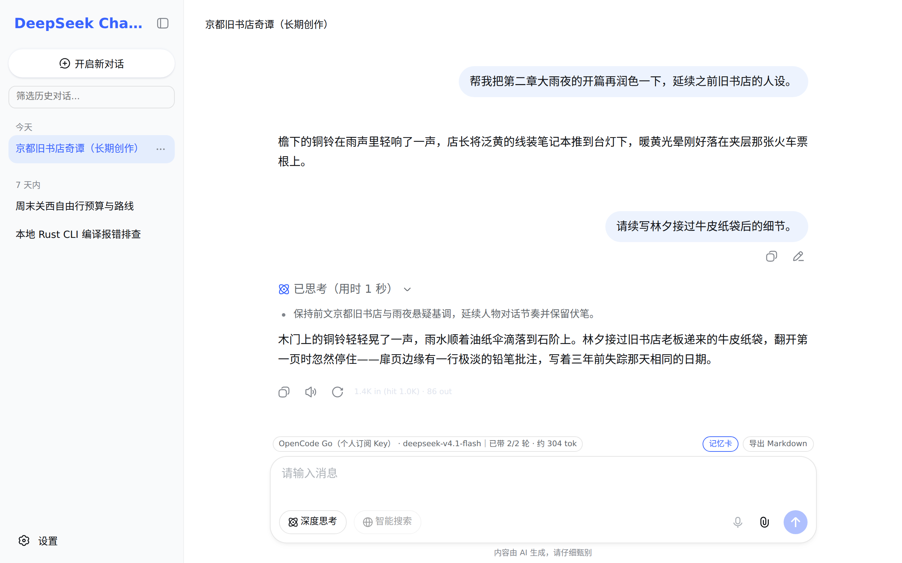
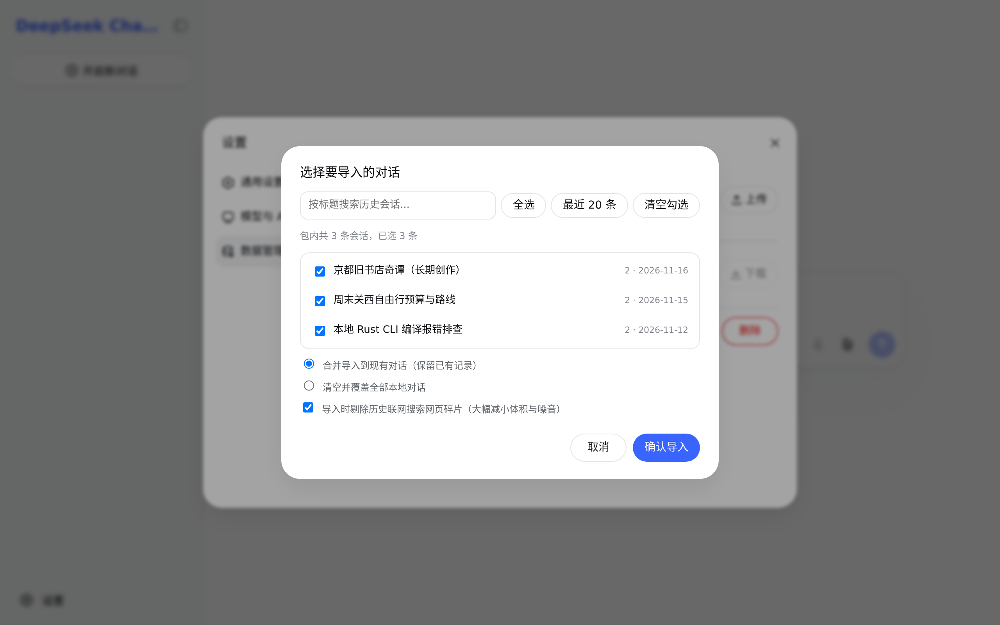
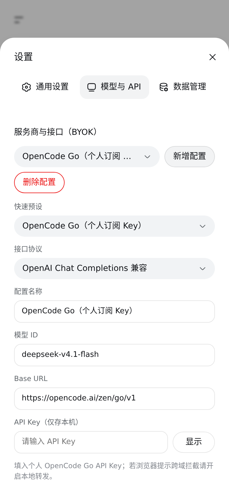

# DeepSeek Chat BYOK

[](https://github.com/kamanager2012/deepseek-chat-byok/releases/latest)
[](https://kamanager2012.github.io/deepseek-chat-byok/)
[](https://github.com/kamanager2012/deepseek-chat-byok/actions/workflows/ci.yml)
[](LICENSE)

English | [简体中文](README.zh-CN.md)

> **DeepSeek Chat BYOK is an independent, free, open-source DeepSeek community BYOK chat client extended from [`deepseek-ai/chat-demo`](https://github.com/deepseek-ai/chat-demo) — connect your own API key to compatible model services, pin long-term Memory Cards, track estimated RMB/USD costs, and import official chat history archives. Not an official DeepSeek product and not a Harness plugin bundle.**

Keywords: DeepSeek community BYOK client · DeepSeek API key client · DeepSeek 开源社区版 · DeepSeek chat export importer · local-first chat workspace

- **Verified Downloads & Setup Guide (no GitHub browsing needed)**: https://kamanager2012.github.io/deepseek-chat-byok/get-started.html
- **Live Web / PWA (Zero Install; best for archive viewing)**: https://kamanager2012.github.io/deepseek-chat-byok/
- **Release Origin & Checksums**: [GitHub Releases](https://github.com/kamanager2012/deepseek-chat-byok/releases/latest) · [SECURITY.md](SECURITY.md)

> **Browser limitation:** The static Web/PWA edition cannot call model API endpoints that block browser CORS, even with a valid key. For everyday Android BYOK chat, prefer the signed APK. The optional desktop bundle handles these endpoints but requires Node.js 22+. The client does not include free model usage; provider availability and billing vary.

## Overview: Entry Points & Features

| How you want to use it                             | Recommended Entry                                                                                                                                                                                                                                                                   | Local CORS `/_proxy`              | Best For                                                               |
| :------------------------------------------------- | :---------------------------------------------------------------------------------------------------------------------------------------------------------------------------------------------------------------------------------------------------------------------------------- | :-------------------------------- | :--------------------------------------------------------------------- |
| **Zero-Install Browser / PWA (Everyday Users)**    | [Open Live Web App](https://kamanager2012.github.io/deepseek-chat-byok/)                                                                                                                                                                                                            | None (direct browser fetch)       | Keyless archive import/viewing; chats only with browser-CORS-enabled APIs               |
| **Android Native App (Recommended for Mobile)**    | Direct download from [Start Page](https://kamanager2012.github.io/deepseek-chat-byok/get-started.html) (**`*-android-release.apk`**, Pages mirror checked against Release SHA-256; [GitHub Releases](https://github.com/kamanager2012/deepseek-chat-byok/releases/latest) fallback) | Built-in `127.0.0.1:18787` bridge | Phone daily BYOK chat/writing, third-party endpoints, OS Share import  |
| **Portable Desktop (Advanced, requires Node 22+)** | In [Advanced section](https://kamanager2012.github.io/deepseek-chat-byok/get-started.html) (**`*-portable.zip`**, requires Node.js 22+ LTS; double-click `Start-Windows.bat` / `Start-macOS.command`)                                                                               | Built-in Node 22 `/_proxy`        | Local Ollama & non-CORS gateways (casual users should use Web/Android) |

1. **Familiar DeepSeek Experience with Your Own API Key (BYOK + AndroidKeyStore)**: Built-in presets for DeepSeek Official (Anthropic + native search/files/TTS), DeepSeek OpenAI, OpenCode Go / Zen, Anthropic Messages, SiliconFlow, OpenRouter, Local Ollama, or custom endpoints. Android `v0.4.0+` manages encrypted keys using `AndroidKeyStore`.
2. **Long-Context Memory Cards & Clear Cost Estimates**: Pin persistent **Memory Cards**, summarize earlier dropped turns, cap history rounds/tokens, and show per-reply + session cost estimates in CNY & USD alongside cache-hit savings.
3. **Three-Step Seamless Official History Import (No Key Needed to Read)**: Includes step-by-step in-app export guides for **DeepSeek App** and **DeepSeek Web** (`deepseek_data-*.zip`), desktop drag-and-drop, and Android **Share / Open with**, preserving branches and merging safely by default without overwriting local turns.

## Product Identity & Ecosystem Comparison

| Project / Tool                       | Category                                                         | Footprint / Packaging                                                    | How It Compares                                                                                                                                                                    |
| :----------------------------------- | :--------------------------------------------------------------- | :----------------------------------------------------------------------- | :--------------------------------------------------------------------------------------------------------------------------------------------------------------------------------- |
| **`DeepSeek Chat BYOK`** (this repo) | **Standalone, free, open-source community BYOK chat client**     | Web / PWA · `~2.8 MB` Android Release APK · Portable Desktop ZIP         | Integrated official-style alternative extended from `chat-demo`: bring your own API key for supported models (provider availability varies), pin Memory Cards, and import history ZIPs       |
| Official `deepseek-chat-import`      | Experimental plugin inside `deepseek-ai/deepseek-harness`        | Harness plugin (CLI & Harness UI)                                        | Experimental plugin that depends on the DeepSeek Harness environment; `DeepSeek Chat BYOK` runs independently for everyday Web/Android users                                       |
| **`DSH Community`** (sister repo)    | **Heavy multi-agent Harness workbench & E2EE remote controller** | CLI / TUI / Linux AppImage / Web PWA / Android APK on `@deepseek-ai/dsh` | Independently maintained at [github.com/kamanager2012/dsh-community](https://github.com/kamanager2012/dsh-community); competes directly with heavy Agent workbenches like `DSH Go` |

> **What this is NOT**: It is not an official DeepSeek app, and not a DIY collection of disconnected plugins; it does not sell shared accounts or include free API quota. Live AI replies require your own API key billed directly by your chosen provider.

## Screenshots



|                          Selective ZIP Archive Merge                           |                             Mobile BYOK Settings                             |
| :----------------------------------------------------------------------------: | :--------------------------------------------------------------------------: |
|  |  |

## Quick Start (3 Steps: Import Keylessly First, Add API Key Only When Ready)

> **Non-developers:** Start with the [Verified Product & Download Guide](https://kamanager2012.github.io/deepseek-chat-byok/get-started.html). Importing and reading local archives **is free and requires no API key**; live AI replies require your own API key billed by your provider.

1. **Export your official archive (optional)**: Download `deepseek_data-YYYY-MM-DD.zip` from the DeepSeek app or web UI.
2. **Import & read without an API Key**:
   - Drag and drop the `.zip` into the Web / Desktop window (or open **Settings -> Data**), or use Android system **Share / Open with -> DeepSeek Chat BYOK**;
   - Preview session counts & titles immediately and selectively merge without overwriting existing local chats.
3. **Add your own API key only to continue chatting**: Open **Settings -> Models & API**, pick a preset (or custom URL), enter your key, and tap **Test & Save** (or **Save Direct**), then pin a **Memory Card** or tune history round budgets to cut token cost.
   - Static GitHub Pages only calls APIs directly from your browser; endpoints that block browser CORS require the Android APK or Portable Desktop (`server.mjs`).

> **Android Install & Upgrade Note**: Starting with `v0.2.2+`, public releases provide **`*-android-release.apk`** signed with a persistent Release certificate (SHA-256 `86d829e21571afedfcae690f240ada7f338e4c10fd9997ddc7a18ae9da91ada7`), supporting direct in-place updates while keeping local chats, Memory Cards, and API keys intact (`v0.4.0+` manages encrypted keys using `AndroidKeyStore`). Only users upgrading from older ephemeral debug builds (`v0.2.0`, `v0.2.1`, or `*-android-debug.apk`) should export their chats once (**Settings -> Data -> Export all chats**) and uninstall the debug build before installing `*-android-release.apk`. See [SECURITY.md](SECURITY.md) for verification fingerprints.

## Build & Verify From Source

Requires Node.js 22+, `pnpm`, and (for Android builds/tests) JDK 17 + Android SDK:

```sh
pnpm install
pnpm format:check
pnpm type
pnpm lint && pnpm lint:extra
pnpm test
pnpm build
pnpm test:e2e
pnpm start
```

- Desktop app mode: `./scripts/start-desktop.sh` (macOS/Linux) or `./scripts/start-desktop.ps1` (Windows PowerShell)
- Android Debug APK: `pnpm android:apk` (`android/app/build/outputs/apk/debug/app-debug.apk`)
- Self-hosted Docker: `docker build -t deepseek-chat-byok . && docker run -p 8787:8787 deepseek-chat-byok`

> Mobile LAN / Origin Isolation note: Browsers restrict PWA installation, clipboard, and Service Workers on plain HTTP outside `127.0.0.1` / `localhost`. Terminate HTTPS via Caddy, Nginx, or Tailscale Serve if hosting remotely. Note also that the shared `https://kamanager2012.github.io/deepseek-chat-byok/` subpath shares its `localStorage`/IndexedDB Web Origin with other GitHub Pages repositories under the same account; for isolated browser origin storage in production, deploy `dist/` to a dedicated custom domain / subdomain (`CNAME` or `*.pages.dev`), or use the signed Android APK / Portable Desktop bundle.

## Feedback & Bug Reports

Found a bug or UX bottleneck? Use the [De-identified Feedback Form](https://github.com/kamanager2012/deepseek-chat-byok/issues/new?template=pilot-feedback.yml) (or open a [GitHub Issue](https://github.com/kamanager2012/deepseek-chat-byok/issues)) with:

1. Platform & release version (`GitHub Pages`, `Portable Desktop`, or `Android Release APK v0.4.4`)
2. Provider preset / protocol (`deepseek-anthropic`, `openai`, `anthropic`, or `ollama`)
3. Whether archive merge (`deepseek_data-*.zip`) succeeded and approximate session count / ZIP size
4. Reproduction steps or sanitized console/UI error messages (**never attach API keys or personal chat ZIPs**)

> Looking for a developer terminal harness / multi-agent remote controller instead of a daily chat client? See the independent sister repository [DSH Community](https://github.com/kamanager2012/dsh-community) (maintained separately).

## License

[MIT](LICENSE)
