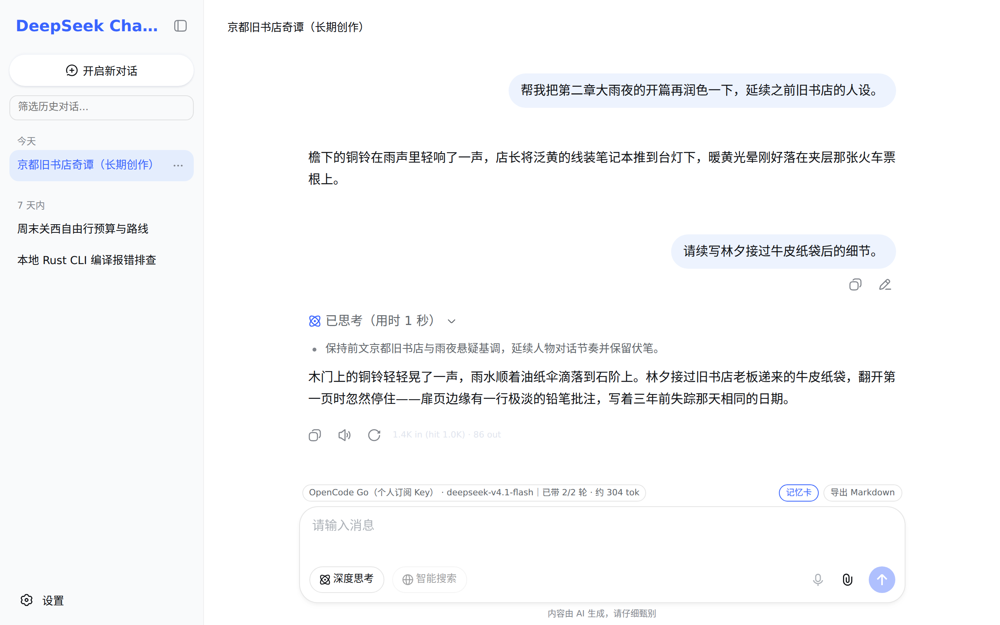
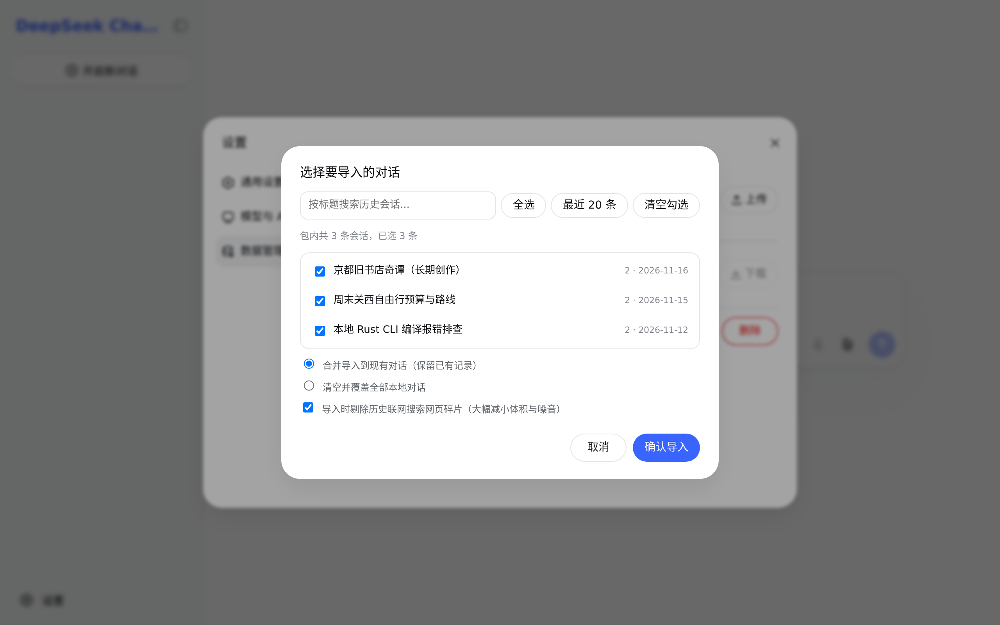
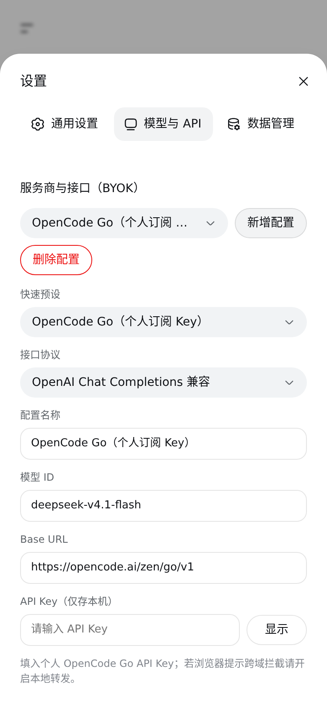

# DeepSeek Chat BYOK

[English](README.md) | 简体中文

- **在线网页 / PWA 版**：https://kamanager2012.github.io/deepseek-chat-byok/
- **安装包下载（Android APK & 便携版桌面端）**：https://github.com/kamanager2012/deepseek-chat-byok/releases
- **安全架构与正式签名手册**：[SECURITY.md](SECURITY.md)

基于 MIT 开源项目 [`deepseek-ai/chat-demo`](https://github.com/deepseek-ai/chat-demo) 扩展的**完全本地、纯工具型（零后端收费 / 零共享密钥）BYOK 聊天、长文写作与 DeepSeek 官方导出历史迁移工具**。

## 30 秒看懂定位与运行形态

| 使用方式                    | 推荐入口                                                                                             | 内置本地 `/_proxy`          | 适用场景                                          |
| :-------------------------- | :--------------------------------------------------------------------------------------------------- | :-------------------------- | :------------------------------------------------ |
| **零安装网页 / PWA**        | [打开在线版](https://kamanager2012.github.io/deepseek-chat-byok/)                                    | 无（浏览器直连）            | 支持跨域的官方/三方接口、快速预览导出包           |
| **Android 独立 APK**        | 在 [Releases](https://github.com/kamanager2012/deepseek-chat-byok/releases) 下载 `android-debug.apk` | 内置 `127.0.0.1:18787` 桥接 | 手机高频聊天/写作、直连任意兼容 API、系统文件导出 |
| **电脑便携版 / 本地桌面窗** | 下载 `portable.zip` 或运行 `./scripts/start-desktop.*`                                               | 内置 Node 22 `/_proxy`      | 电脑独立应用窗口、无 CORS 网关、本地 Ollama       |

1. **老对话防卡死迁移**：无需把几百 MB 的官方导出包一次性塞进内存。直接读取 `chat_session_index.json` 目录索引秒开列表，支持搜索、勾选并**合并导入**到现有会话（不覆盖已有记录与记忆卡），默认剔除膨胀的旧联网搜索网页碎片。
2. **多服务商自带密钥（BYOK）**：支持保存并切换 DeepSeek 官方（Anthropic + 搜索/文件/语音）、DeepSeek OpenAI、OpenCode Go / Zen、Anthropic Messages、硅基流动 SiliconFlow、OpenRouter、本地 Ollama 与任意自定义端点；所有 Key 仅存本机 `localStorage`，备份包永不携带。
3. **对抗低缓存与长文本费率**：支持按轮数与 Token 预算裁剪上文，配合固定 **记忆卡（Memory Card）**（支持手动编辑或用当前模型一键浓缩早期对话）、逐条回复 `in (hit X) · out` 用量显示与一键导出 Markdown。

## 界面实机截图



|                  官方导出包目录预览与选择性合并                   |                   移动端（390px）BYOK 接口配置                    |
| :---------------------------------------------------------------: | :---------------------------------------------------------------: |
|  |  |

## 三步快速上手

1. **准备官方导出包（可选）**：在 DeepSeek 官网或 App「设置 → 个人资料 / 数据导出」下载 `deepseek_data-YYYY-MM-DD.zip`。
2. **填入自己的 API Key**：打开 **设置 → 模型与 API**，选中预设并填入个人 Key，点击 **「测试并保存」**（若网关未开放 `GET /models`，可直接点 **「直接保存」**）。
   - 纯静态网页版受浏览器同源安全策略约束，无法请求未返回 CORS 头的第三方接口；此类接口建议使用 **Android APK** 或 **电脑便携版**。
3. **选择性合并导入并续写**：在 **设置 → 数据管理** 导入 ZIP，勾选需要恢复的会话合并导入，按需设置 **「记忆卡」** 即可低开销续聊。

> Android 安装升级说明：当前公开 `Releases` 提供 CI Debug 签名的 `android-debug.apk`。由于未配置固定发布证书时各次 CI 构建的临时 Debug 签名不一致，**请先导出备份（设置 → 数据管理 → 导出所有历史对话）再卸载旧安装包**，装入新版本后导回备份并重新填入 API Key；固定证书签名配置方法见 [SECURITY.md](SECURITY.md)。

## 从源码构建与校验

需准备 Node.js 22+、`pnpm`，构建与验证 Android 桥接需 JDK 17 与 Android SDK：

```sh
pnpm install
pnpm format:check
pnpm type
pnpm lint && pnpm lint:extra
pnpm test
pnpm build
pnpm test:e2e
pnpm start
```

- 桌面独立窗口：`./scripts/start-desktop.sh`（macOS / Linux）或 `./scripts/start-desktop.ps1`（Windows PowerShell）
- 编译 Android Debug APK：`pnpm android:apk`（输出 `android/app/build/outputs/apk/debug/app-debug.apk`）
- 容器化部署：`docker build -t deepseek-chat-byok . && docker run -p 8787:8787 deepseek-chat-byok`

> 局域网 / VPS 提示：非本机 `127.0.0.1` 的明文 `http://` 访问会被现代浏览器限制 PWA 安装、剪贴板与 Service Worker。远程访问建议通过 Caddy、Nginx 或 Tailscale Serve 前置 HTTPS。

## 外部试用反馈收集清单

欢迎在 [GitHub Issues](https://github.com/kamanager2012/deepseek-chat-byok/issues) 提交可复现试用反馈，建议附带以下 4 项信息：

1. 使用端与版本（在线 GitHub Pages / 电脑便携版 / Android APK `v0.2.2`）
2. 所选接口预设与协议（DeepSeek 官方 / OpenCode Go / SiliconFlow / Ollama / 自定义等）
3. `deepseek_data-*.zip` 导入体积、会话数量与是否顺利合并保留旧记忆
4. 首次配置 Key、流式输出、记忆卡压缩或跨域报错中的具体卡点描述

## 许可证

沿用上游 [MIT](LICENSE) 许可证。
