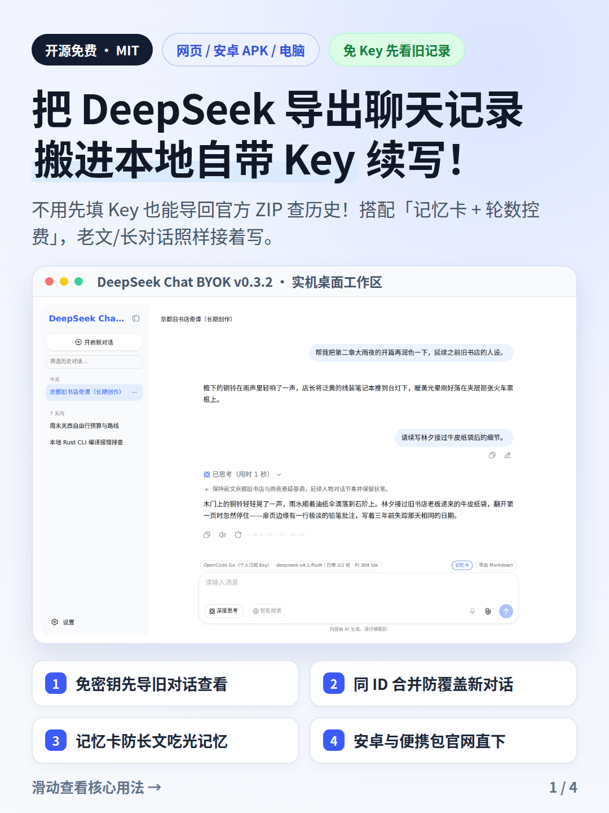
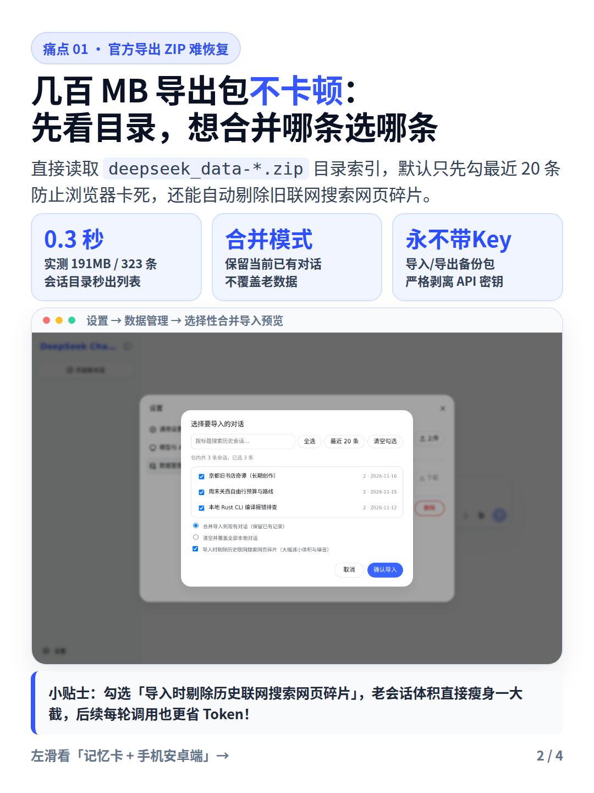
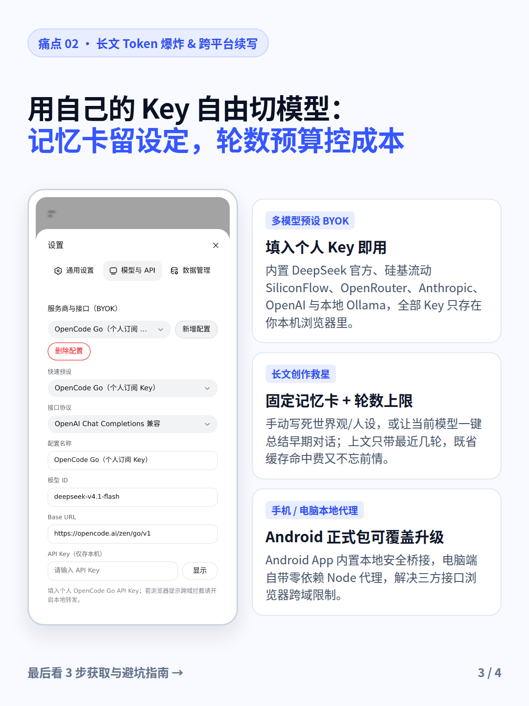
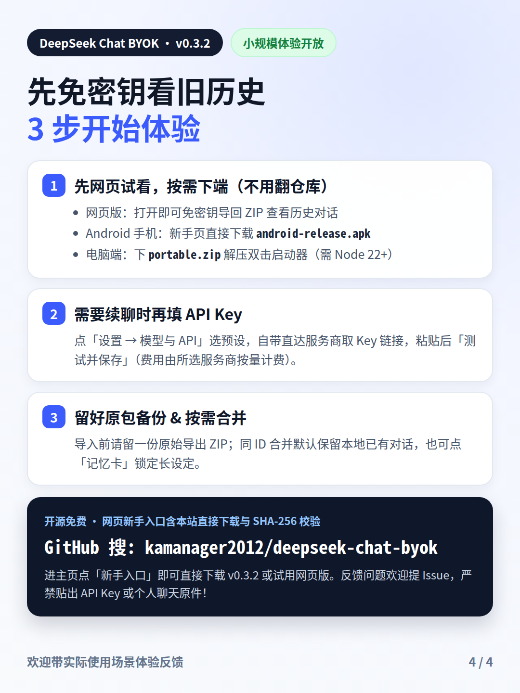

# DeepSeek Chat BYOK · 小红书冷启动发帖成品包（v0.3.2 体验版）

> 定位原则：**诚实透明、不吹「绝对零丢失」或未经全部设备核验的绝对化承诺、不放违禁外链与二维码防限流**，面向 10–20 位愿意真实试用反馈的体验用户，聚焦三个明确可验证痛点：**官方导出 `deepseek_data-*.zip` 选择性迁移**、**长对话记忆卡与预算控制**、**自带 API Key 本地留存与多端使用**。

---

## 一、配图成品（共 4 张，已按小红书最佳 3:4 竖图 `1080×1440` 渲染完毕）

上传顺序建议：**封面 → 痛点 01（导入） → 痛点 02（记忆卡+手机端） → 3 步上手与开源检索入口**。

|                                     图 1 · 封面                                     |                            图 2 · 导出包导入                            |
| :---------------------------------------------------------------------------------: | :---------------------------------------------------------------------: |
|  |  |

|                               图 3 · 记忆卡与 BYOK                               |                          图 4 · 新手 3 步上手                           |
| :------------------------------------------------------------------------------: | :---------------------------------------------------------------------: |
|  |  |

文件列表：

- 图 1 封面：`./xhs-slide-1-cover.png`
- 图 2 导入：`./xhs-slide-2-import.png`
- 图 3 记忆卡与多端：`./xhs-slide-3-memory-byok.png`
- 图 4 上手引导：`./xhs-slide-4-howto.png`

---

## 二、标题备选（3 选 1，前 18 字必须见痛点）

1. **创作/历史迁移党首选（推荐首发）**：
   `把 DeepSeek 导出聊天记录搬进本地！自带 Key 续写还不卡`
2. **省钱/自带 Key 极客向**：
   `做了个纯本地 DeepSeek 客户端，导回几百兆旧对话接着聊`
3. **手机/长文用户直击向**：
   `长文写一半想换地方续聊？这几个开源功能把本地备份救活了`

---

## 三、可直接复制的正文（2 套口径）

> 合规提醒：小红书正文和图片里**不要放带 `https://` 的直链或二维码**（极易触发站外引流限流）。正文用「GitHub 搜仓库名」或引导看评论区置顶是最稳妥的做法。

### 版本 A · 历史导出 + 长文写作共鸣版（最易出互动与收藏，推荐先发这版）

```text
之前在 DeepSeek 聊了几百条长对话和小世界观设定，想从官方「数据导出」拿回来本地存着，结果导出来是一整个巨大的 ZIP 压缩包，解压全是 JSON，根本没法直接接着聊 😭

后面干脆在官方开源的 chat-demo 基础上改了个纯本地优先的开源客户端（MIT 协议，无后台服务器、不卖订阅、不存你任何 Key）：

1️⃣ 几百 MB 导出包按需合并（不用先填 Key，默认保护本地已有记录）
v0.3.2 打开无需先填任何 API Key，直接点「导入旧对话（无需密钥）」即可扫 ZIP 目录索引（实测 191MB / 323 条对话约 0.3 秒列出清单）；想恢复哪几条勾哪几条，导入后直接定位到最新会话。「合并导入」遇到同 ID 会话默认严格保留你本地现有新内容，还会顺手剔除旧联网搜索网页碎片。**（提醒：动手合并前仍建议保留一份原始导出包备份。）**

2️⃣ 长文续写：固定记忆卡 + 轮数控制费率
对话长了全塞上下文既贵又容易跑偏，现在可以把人物设定/前情提要钉死在「记忆卡」里（也能一键让当前模型把早期内容浓缩成摘要），配合只带最近 N 轮上下文，省得离谱。

3️⃣ 需要续聊时再填 API Key（BYOK，工具本身免费不送额度）
DeepSeek 官方、硅基流动 SiliconFlow、OpenRouter、Anthropic 或者本机 Ollama 都有配置预设并附带官方取 Key 入口；钥匙只存在你自己的浏览器/手机本机（注：Web 版存浏览器 `localStorage`，Android 版存应用沙盒私有存储），导出备份包永不夹带密钥。

📱 运行端形态（新手页直接下载，不用翻 GitHub 仓库）：
• 电脑/手机免装：GitHub Pages 在线体验版 + 新手引导页（仅读/导旧聊天完全不挑网络代理；如需调未开浏览器 CORS 的三方接口，建议用下面两个客户端）
• 安卓独立 App：v0.3.2 新手页提供与 GitHub Release 同校验的直接下载（`android-release.apk`），同证书新版可直接覆盖升级保留本地对话、记忆卡与 Key
• 电脑便携端：同样可在新手页直接下 `portable.zip`，解压双击 `Start-Windows.bat` 或 `Start-macOS.command` 启动（需预装 Node 22+ LTS），内置本地代理解决第三方接口跨域问题

🔎 怎么找：
GitHub 搜仓库名 deepseek-chat-byok（作者 kamanager2012），点简介里的「新手入口」就能先免 Key 试导对话并直接下载 v0.3.2 安装包（国内部分网络直连 GitHub Pages 仍可能受限，下载失败可在社区评论或 Issue 反馈）。

目前先做小规模早期体验收集，欢迎带真实使用场景、配置和导入卡点直接评论区交流或提 Issue（千万别贴 API Key 或私密聊天压缩包）！
```

### 版本 B · 工具流短平快版（适合二次复用或偏极客受众）

```text
给经常折腾 DeepSeek 导出备份、多服务商 API 的朋友分享一个自改开源小工具（纯工具无收费、MIT 开源）：DeepSeek Chat BYOK。

解决三个具体小麻烦：
1. 打开免填 Key，直接用官方 `deepseek_data-*.zip` 目录预览 + 选择性合并导入，不覆盖现存新记录，顺带一键过滤老搜索网页块。
2. 固定「记忆卡」+ 可调携带轮数，写长设定不用每轮重吃几十万字上文，还带单条缓存命中统计。
3. v0.3.2 新手页直接提供 Android 正式版 APK 与电脑便携包直下（便携包解压含 `Start-Windows.bat` / `Start-macOS.command` 双击入口，需 Node 22+），不用自己去翻 GitHub Releases。

指路：GitHub 搜 kamanager2012/deepseek-chat-byok，点简介「新手入口」即可直接试用并下载 v0.3.2（导入查看免费无需 Key，续聊按自备 API 服务商计费；试用前记得留原始导出备份，反馈禁止贴 Key 或隐私聊天原件）。
```

---

## 四、建议话题标签（正文末尾选 6–8 个）

`#DeepSeek #AI工具 #AI写作 #开源项目 #API #本地部署 #长文写作 #安卓宝藏应用 #Chat客户端`

---

## 五、发布后 5 分钟自抢首评（置顶引导 + 防踩坑）

> 发完笔记后用自己账号抢 1 楼评论并点「置顶」，方便新人照着操作（同样不带完整域名避免被吞，等有用户问链接后再单独回复或引导搜仓库名）：

**置顶评论文案：**

```text
给来试用的朋友划 3 个重点省时间：
1）GitHub 搜仓库 kamanager2012/deepseek-chat-byok，简介里点「新手入口（get-started）」就能直接下载 v0.3.2 安卓正式版或电脑包，不用自己找 Releases；
2）只想导入查看旧记录可以不填任何 Key；需要让 AI 继续生成新回复时再到「设置 → 模型与 API」按引导链接申请并填入自己的 Key（网页版报跨域就换安卓 APK 或电脑便携版）；
3）安卓端请认准 android-release.apk（同证书可直接覆盖升级），便携电脑端仍需电脑先装 Node 22+；反馈问题务必脱敏，严禁贴出 API Key 或个人聊天原件！
```

---

## 六、发布实操与收反馈动作清单（供回传迭代）

1. **发布时间建议**：工作日 **12:00–13:30** 或 **19:30–22:30**（AI 工具与创作人群高峰）。
2. **前 1 小时互动重点**：只要有人问「怎么下」「iOS/安卓能用吗」「怎么填 Key 卡住了」，第一时间简短回复，推首轮自然曝光；
3. **回流闭环**：把小红书评论区遇到的**真实报错/卡点/高频吐槽**直接发回这里，我按优先级修完直接再出新版接住转化。
